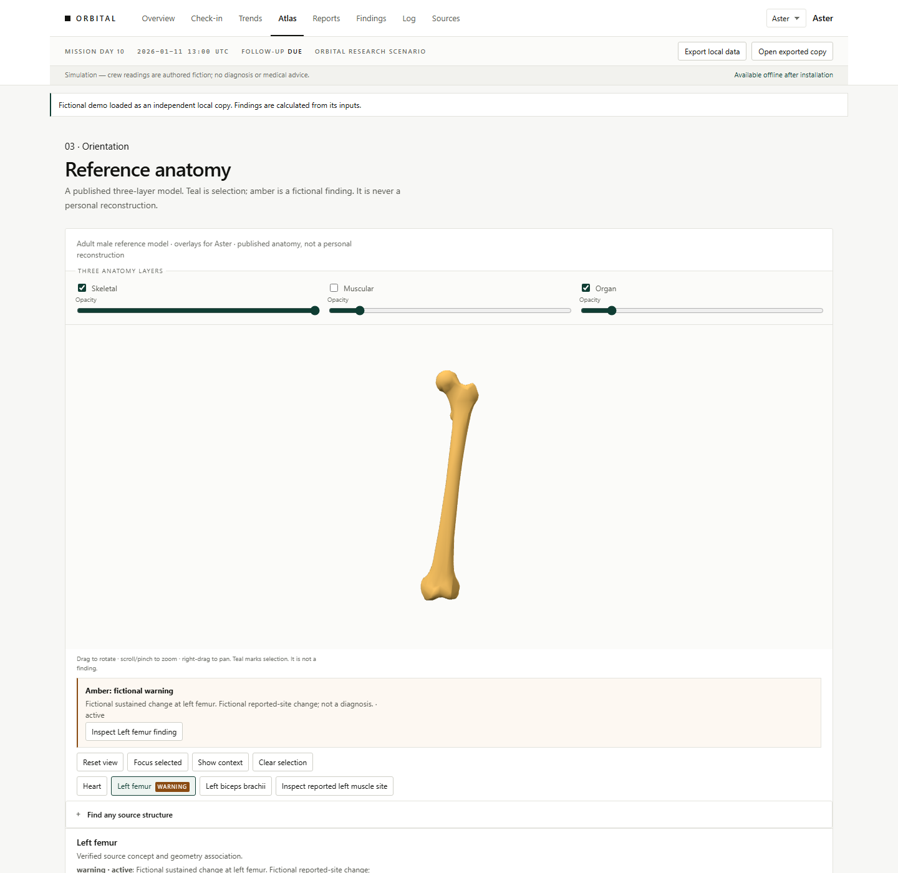

# ORBITAL

A research prototype connecting astronaut health readings, personal references, explainable follow-ups and a three-layer reference anatomy atlas.

**Simulation only.** Crew measurements and alert rules are fictional. This is not a medical device or a diagnostic system.



## Run locally

Requires Node.js 24.20 or newer within version 24. No accounts, API keys or server database are required.

```sh
git clone https://github.com/ocr1n/NASA_Project.git
cd NASA_Project
npm ci
npm run dev
```

Open the URL printed by Vite. On Windows, you can also run **START_LOCAL.cmd**.

## Try the working demo

1. Open **Overview**, scroll below the Flight log to **Demo scenarios**, and choose **Load bone change demo**.
2. Open **Atlas**, inspect the left femur and choose **Isolate selected**. Amber marks a fictional warning; teal marks selection.
3. Return to **Overview** to confirm site/device details and record the astronaut's response.
4. Apply the next scripted inputs. Task completion and recovery are tracked separately; a response alone cannot clear the finding.

Try the uncertain-quality and single-reading examples to see when the atlas stays unhighlighted. [Full walkthrough and ECG upload](docs/DEMO_GUIDE.md).

## What works

- Two fictional crew profiles with separate histories and drafts.
- Daily check-ins, exercise and numerical ECG/ultrasound report entry/import.
- Fixed preflight, single-exam and rolling references; descriptive trends preserve gaps and unknowns.
- Input-driven bone/muscle demo findings, follow-up prompts and retained recovery history.
- Rotatable skeletal, muscular and organ layers with linked evidence.
- Recording-based mission progress, flight log, local export/restore and offline reopening after installation.

Our contribution is the connected, inspectable workflow: **measurement → personal comparison → cautious finding → reported region → follow-up → recovery evidence**. Progress records activity, not a health score.

## Explore

[30-second, three-person script](DEMO_SCRIPT.md) · [Architecture](docs/ARCHITECTURE.md) · [Validation](docs/DATA_VALIDATION.md) · [Verification](docs/VERIFICATION.md) · [Sources](docs/DATA_SOURCES.md) · [Data dictionary](docs/DATA_DICTIONARY.md)

Live sensors, ECG image/PDF/raw-waveform analysis, operational medical rules, backend synchronization and individualized anatomy are outside this build. Public ECG research remains separate from fictional crew data.

BodyParts3D and PTB research excerpts retain their own licenses. Original project-code licensing has not been selected. See [NOTICE](NOTICE.md) and [disclaimer](DISCLAIMER.md).
